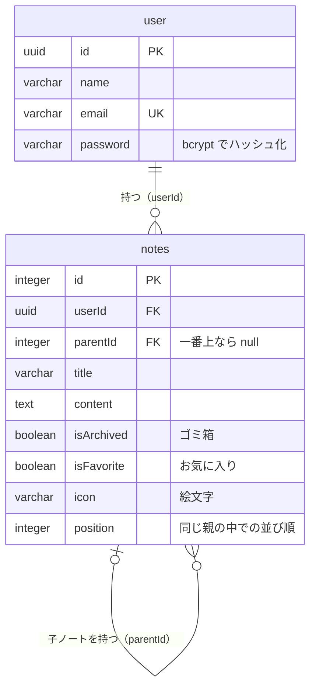

# Notion Clone

[](https://github.com/haruharukik0210-cpu/notion-clone/actions/workflows/ci.yml)

Notion のように、ページ（ノート）を階層で整理して書けるメモアプリです。
講座でベースを作ったあと、**機能の追加・本番運用・テストと CI** を自分で進めています。

- **デモ**：https://notion-clone-one-delta.vercel.app
- **お試しアカウント**：準備中（ログイン画面の「ゲストで試す」から、登録なしで触れるようにする予定）
- **API のリポジトリ**：[notion-clone-api-postgres](https://github.com/haruharukik0210-cpu/notion-clone-api-postgres)

> [!NOTE]
> API は Render の無料プランで動いています。しばらくアクセスがないとサーバーが休止するため、**最初の表示に 30〜60 秒ほどかかる**ことがあります。

<!-- TODO：ドラッグで並び替える様子の GIF を docs/images/demo.gif に置いて、下の行のコメントを外す -->
<!--  -->

---

## このリポジトリで見てほしいところ

| 見どころ | どこを見ればよいか |
| --- | --- |
| ドラッグ＆ドロップでの並び替え（楽観的更新） | [`NoteList/index.tsx`](src/components/NoteList/index.tsx)・[`notes.utils.ts`](src/modules/notes/notes.utils.ts) の `reorderNotes` |
| ロジックを純粋な関数に分けて、テストしている | [`notes.utils.test.ts`](src/modules/notes/notes.utils.test.ts) |
| E2E テスト（API はモック） | [`e2e/`](e2e/) |
| PR ごとの自動チェックと、master の保護 | [`.github/workflows/ci.yml`](.github/workflows/ci.yml) |
| 機能ごとの設計メモ（何を考えて、どう決めたか） | [`docs/`](docs/) |

---

## 機能

### 講座で作った部分（ハンズオンで実装）

| 機能 | 内容 |
| --- | --- |
| ログイン・新規登録 | JWT で認証 |
| ノートの作成・編集 | タイトルと本文（ブロックエディタ BlockNote）。入力は自動で保存 |
| 子ノート | ノートの中にノートを作って、階層で整理 |
| 検索 | タイトルでノートを探す（コマンドパレット） |

講座の動画に沿って手を動かして実装し、**処理の流れを自分で説明できるところまで理解してから**、次の追加機能に進みました。

### 自分で追加した部分

| 機能 | 内容 | 設計メモ |
| --- | --- | --- |
| ゴミ箱 | 削除したノートを一覧で見て、元に戻す・完全に削除する。消さずに印を付ける**論理削除** | [trash-guide.md](docs/trash-guide.md) |
| ダークモード | CSS 変数で色を切り替え。選んだ設定を `localStorage` に保存 | [dark-mode-guide.md](docs/dark-mode-guide.md) |
| お気に入り | サイドバーの上にお気に入りだけを表示 | [favorite-guide.md](docs/favorite-guide.md) |
| 絵文字アイコン | ノートごとに絵文字を設定（DB に列を追加） | [icon-guide.md](docs/icon-guide.md) |
| **ドラッグ＆ドロップ** | サイドバーのノートを、同じ階層の中で並び替える。並び順は DB に保存し、再読み込みしても残る | [dnd-guide.md](docs/dnd-guide.md) |
| テスト・CI | Vitest・Playwright・GitHub Actions。master は PR とチェック必須 | [testing-ci-guide.md](docs/testing-ci-guide.md)・[e2e-guide.md](docs/e2e-guide.md) |
| 本番運用 | Vercel（フロント）・Render（API）・Neon（DB）にデプロイ。DB の引っ越しも実施 | [db-migration-guide.md](docs/db-migration-guide.md) |

---

## 設計で考えたこと

### 1. 並び替えは「楽観的更新」にした

ノートを離したら、**API の返事を待たずに先に画面を並び替え**、失敗したときだけ元に戻します。

| | 楽観的更新（採用） | 返事を待つ |
| --- | --- | --- |
| 離した直後 | すぐ新しい並びになる | 返事が来るまで元の位置に戻って見える |
| サーバーが休止中（数十秒） | すぐ並び替わる | 数十秒止まって、壊れたように見える |
| 失敗したとき | 元の並びに戻す処理が必要 | 何もしなくてよい |

無料サーバーは起動に時間がかかるため、待たせない方を選びました。元に戻せるように、並び替えの関数は**元の配列を書き換えない**作りにして、テストでも確かめています。

### 2. 並び順は「同じ親の中での番号」で持つ

| id | タイトル | parentId | position |
| --- | --- | --- | --- |
| 1 | 買い物メモ | null | 0 |
| 2 | 読書記録 | null | 1 |
| 4 | 本のリスト | 2 | **0** ← 親が違えば、また 0 から |

- 並び替えの API には、**並び替えたあとの id の順番**（`{ ids: [3, 1, 2] }`）を送り、サーバーはトランザクションで番号を振り直します。「何をどこに動かしたか」を送るより、ずれにくいからです
- 親子のつながり（`parentId`）と並び順（`position`）を分けて持っているので、親を動かすと子もそのままついてきます

### 3. データと表示を分ける

フロントの store には、全部の階層のノートがまとめて入っています。並び順は「同じ親の中」でしか意味がないので、**サイドバーで階層ごとに絞り込んだあとで、`position` の順に並べて**います。store には並び順の責任を持たせていません。

### 4. 既存のバグに気づいて直した

store でノートをまとめる `mergeNotes` が `Object.values` を使っていて、**数字のキーが小さい順（id 順）に並び直っていた**ため、API が返した順番が画面に届いていませんでした。並び替えを作る前の調査で見つけ、表示する直前に並べる形にしました。

### 5. ロジックと見た目を分けてテストしやすくする

並び替えの計算（`reorderNotes`）は、ドラッグのライブラリ（dnd-kit）を知らない**純粋な関数**にしました。id を 2 つ渡すだけでテストできます。

| テストした場面 | 例 |
| --- | --- |
| 上へ・下へ・となりへ動かす | `1, 2, 3` で 3 → 1 なら `3, 1, 2` |
| 動かしていない | `2 → 2` ならそのまま |
| ない id が来た | そのまま返す（エラーにしない） |
| position の振り直し | 並びどおりに 0, 1, 2 |

### データベース（ER 図）



くわしくは [er-diagram.md](docs/er-diagram.md)。

---

## 品質を守る仕組み

| 仕組み | 内容 |
| --- | --- |
| ユニットテスト（Vitest） | ノートの結合・子孫の検索・パンくず・並び替え。**19 件** |
| E2E テスト（Playwright） | ログイン → サイドバー表示、ノート作成 → 詳細へ移動。API は `page.route` でモックし、本物の API と同じ形で返す |
| CI（GitHub Actions） | PR ごとに Lint・型チェック・ビルド・ユニットテスト・E2E |
| master の保護 | PR を通さないと入れない。CI が通らないとマージできない |

---

## 使った技術

| 分類 | 技術 |
| --- | --- |
| フロントエンド | React 19 / TypeScript / Vite |
| 状態管理 | Jotai |
| ドラッグ＆ドロップ | dnd-kit（core + sortable） |
| エディタ | BlockNote |
| テスト | Vitest / Playwright |
| バックエンド | Express / TypeORM / PostgreSQL（[別リポジトリ](https://github.com/haruharukik0210-cpu/notion-clone-api-postgres)） |
| インフラ | Vercel / Render / Neon / GitHub Actions |

---

## AI の使い方

AI（Claude）を使って開発しています。**フロントエンドのロジックを自分で理解すること**を目的にしているので、役割を分けて使いました。

| 範囲 | 進め方 |
| --- | --- |
| **フロントエンドのロジック**（state、API 呼び出し、並び替え、楽観的更新、テスト） | **自分で書く**。AI はヒントとレビューだけ。詰まったときは答えを見て、理由を説明できるようにしてから進める |
| 動きの仕様 | 本家の Notion を触って観察し、「操作 → 期待する結果」の表（シナリオ表）を自分で作ってから実装 |
| 見た目（CSS・UI 部品） | AI が実装 |
| バックエンド・CI の設定・DB のマイグレーション | AI が実装し、解説を受けて理解したうえで、自分でレビュー・動作確認・マージ |
| 手順書（`docs/`） | AI が下書きし、実装しながら自分の理解に合わせて更新 |

コミット・PR・マージ・本番の設定は、すべて自分で行っています。

---

## 手元で動かす

Node.js 24（`.nvmrc`）を使います。

```bash
npm install
cp .env.example .env   # VITE_API_URL に API の URL を書く
npm run dev
```

| コマンド | 内容 |
| --- | --- |
| `npm run dev` | 開発サーバー |
| `npm run build` | 型チェック＋ビルド |
| `npm run lint` | ESLint |
| `npm test` | ユニットテスト（Vitest） |
| `npm run test:e2e` | E2E テスト（Playwright） |
