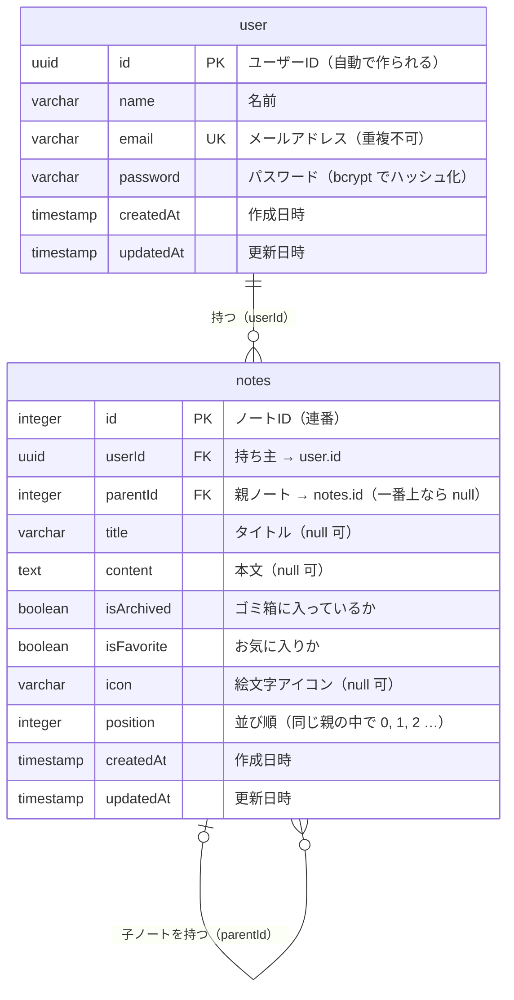

# ER 図（データベースの設計図）

API（`notion-clone-api-postgres`）の DB を図にしたものです。`position` は PR（`feat/note-position`）で足す列も含めています。

**ER 図とは**：テーブル（**E**ntity＝もの）と、テーブル同士のつながり（**R**elationship＝関係）を表した図です。

## 図

## 用語

| 用語 | 意味 | この DB での例 |
| --- | --- | --- |
| **PK**（主キー） | 1行を見分けるための、重複しない番号 | `user.id`・`notes.id` |
| **FK**（外部キー） | ほかの行の PK を指す列。「どれとつながっているか」を表す | `notes.userId` → `user.id` |
| **UK**（ユニーク） | 同じ値を2つ入れられない列 | `user.email`（同じメールで2回登録できない） |
| **自己参照** | 同じテーブルの別の行を指す FK | `notes.parentId` → `notes.id` |
| **CASCADE**（カスケード） | 指している先が消えたら、一緒に消える | ユーザーを消すと、そのノートも全部消える |

## 関係（つながり）

| 関係 | 種類 | FK | 消したとき |
| --- | --- | --- | --- |
| ユーザー → ノート | 1対多（1人が、0個以上のノートを持つ） | `notes.userId`（必須） | ユーザーを消す → ノートも全部消える |
| 親ノート → 子ノート | 1対多（1つのノートが、0個以上の子を持つ） | `notes.parentId`（null 可） | 親を消す → 子・孫も全部消える |

### 図の記号の読み方

線の両端の記号で「いくつとつながるか」を表します。

| 記号 | 意味 |
| --- | --- |
| `\|\|` | ちょうど1つ |
| `\|o` | 0か1つ |
| `o{` | 0個以上（たくさん） |

- `user ||--o{ notes`：ユーザー1人に、ノートが0個以上
- `notes |o--o{ notes`：ノートには親が0か1つ（一番上なら親なし）、子が0個以上

## インデックス（検索を速くするための目次）

| テーブル | 列 | 種類 | 使われる場面 |
| --- | --- | --- | --- |
| user | `email` | ユニーク | ログイン（メールでユーザーを探す） |
| notes | `userId` | ふつう | 自分のノート一覧 |
| notes | `parentId` | ふつう | 子ノートの一覧・子孫を探す |
| notes | `createdAt` | ふつう | 作成日時の順に並べる（検索結果） |

**インデックスとは**：本の巻末の索引と同じです。全部のページをめくらなくても、目的の行にすぐたどり着けます。

## この設計のポイント

- **ノートの階層は、テーブル1つで表している**：「親ノート」「子ノート」を別のテーブルにせず、`parentId` で自分のテーブルを指しています。何階層でも同じ形で表せます
- **並び順は `parentId` ごと**：`position` は「同じ持ち主・同じ親」の中での順番です。親が違えば、また 0 から数えます
- **ゴミ箱は「消さずに印を付ける」**：`isArchived` を true にするだけで、行は残ります（**論理削除**）。本当に消すのは、ゴミ箱から完全に削除したときだけです
- **パンくずは列にしない**：「祖父 / 親」は `parentId` をたどれば計算できるので、DB には保存していません

## たとえ（EC サイト）

| この DB | EC サイトでいうと |
| --- | --- |
| `user` ↔ `notes`（1対多） | 顧客 ↔ 注文（1人の顧客が、たくさん注文する） |
| `notes.parentId`（自己参照） | カテゴリの親子（「メンズ」→「トップス」→「T シャツ」） |
| `position` | コレクション内の商品の並び順（手動で並び替え） |
| `isArchived` | 商品を「非公開」にする（消さずに隠す） |

## Mermaid の見方

`docs/er-diagram.md` を GitHub で開くと、図として表示されます。VS Code では、拡張機能（Markdown Preview Mermaid Support など）を入れると、プレビューで図になります。
